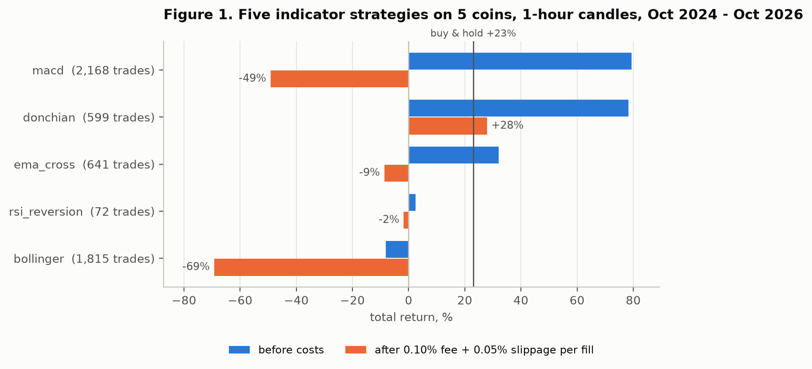
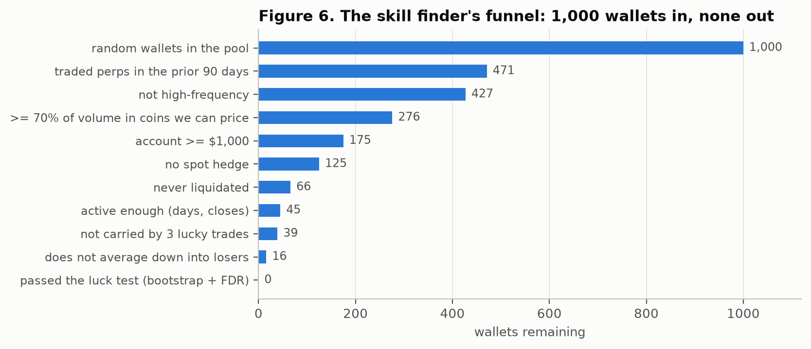
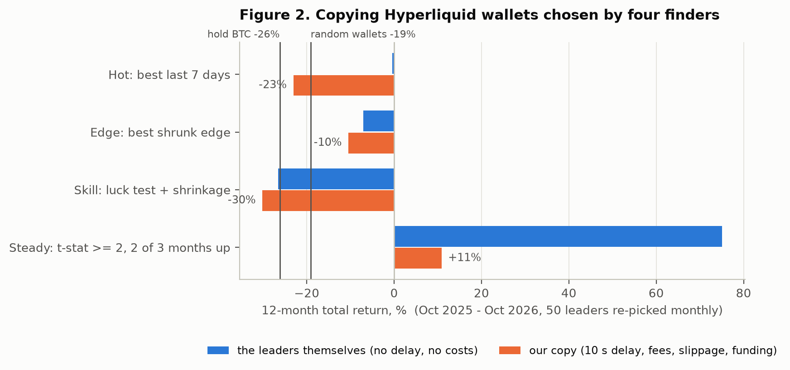
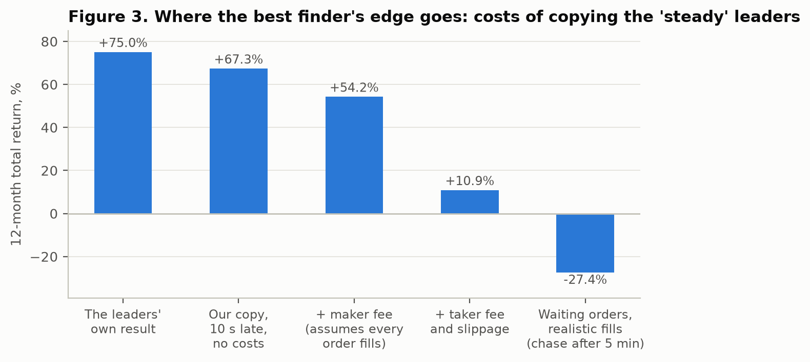
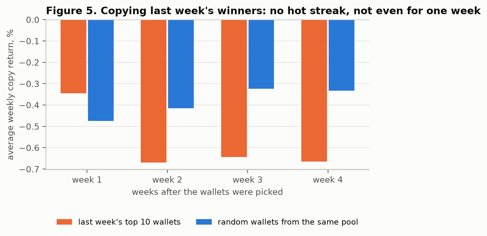
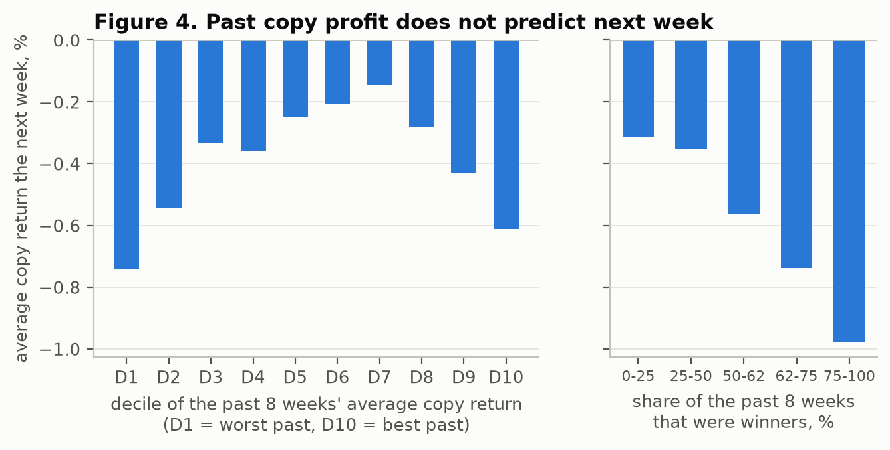
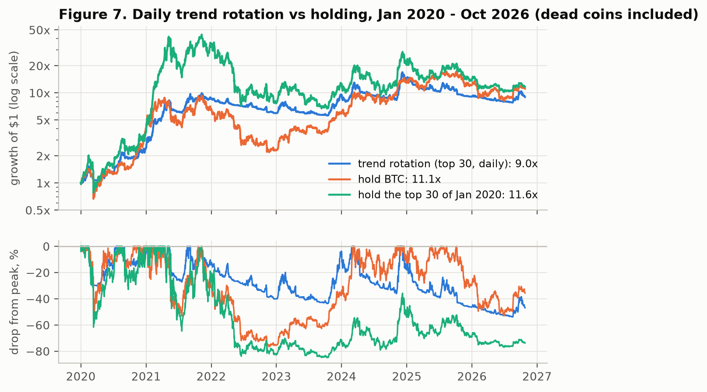

# No Free Alpha: Transaction Costs, Luck, and the Limits of Algorithmic, LLM-Driven and Copy Trading for Retail Crypto Investors

**Evidence from cost-aware backtests and a walk-forward replay of 1.5 million Hyperliquid wallets, 2019–2026**

Ammar H. Sufyan · Independent research · October 2026

*Code, result files and the scripts that rebuild every figure: https://github.com/AmmarHSufyan/no-free-alpha .
This paper is not investment advice.*

---

## Abstract

Products sold to retail traders in 2026 promise that automated strategies, large language model (LLM) agents and
copy trading of on-chain "smart money" can beat the market. We test these promises with simulated capital on
historical data. Every trade is charged realistic exchange fees and slippage, and every result is compared with
buy-and-hold. We study five families of strategy:

1. five classic indicator strategies on 1-hour candles of five large cryptocurrencies (October 2024 to October 2026);
2. eleven published community strategies for the Freqtrade framework;
3. a pilot LLM trading agent: Claude, behind a tool-less, schema-constrained interface, reading anonymised candles;
4. copy trading of Hyperliquid perpetual-futures wallets. Leaders are chosen by four "finders", one of them a
   principled skill finder that combines block-bootstrap tests, false-discovery-rate control and empirical-Bayes
   shrinkage. The copies are replayed walk-forward over 12 months with a 10-second delay, fees, slippage and
   funding, using the complete public fill ledger (457 days, 1,509,029 wallets);
5. a slow, volatility-scaled daily trend rotation over a point-in-time top-30 universe that includes delisted
   coins (2020 to 2026).

After costs, no strategy beat holding Bitcoin over its full test window.

- **Costs:** costs turned a +79% gross indicator strategy into −49%.
- **Copy trading:** copying lost money with three of the four finders (−10.5% to −30.2%), against −19.1% for
  random wallets and −26.2% for Bitcoin. The exception (+10.9%) owed its gain to one cluster of related wallets,
  and its ranking failed on an independent pool.
- **Persistence:** past copy profitability did not predict the next week (Spearman ρ = 0.04 over 33,927
  wallet-weeks). Wallets that won more than 75% of their past weeks lost the most afterwards.
- **Trend rotation:** the trend rotation cut the worst drawdown from −77% to −54%. But it compounded at 38.0% a
  year against 42.4% for Bitcoin, and in 2023 to 2026 it gave no drawdown protection at all.

We conclude that what holds a retail participant back in 2026 is transaction costs and the difficulty of telling
skill from luck, not a shortage of computing power or model intelligence.

**Keywords:** cryptocurrency, backtesting, transaction costs, copy trading, social trading, skill versus luck,
false discovery rate, large language models, trend following, Hyperliquid.

---

## 1. Introduction

Three ideas dominate retail trading in 2026:

- **Automation:** a bot that trades on technical signals around the clock.
- **AI:** an LLM agent that reads the market and decides.
- **Copy trading:** public ledgers such as Hyperliquid's show every wallet's trades, so one can find the skilled
  traders and mirror them.

Each idea is easy to build and easy to demonstrate with a flattering backtest. Few of them are tested the way a
participant would actually live them: out of sample, after costs, against the simple alternative of buying and
holding.

This paper reports such a test. We built our own backtesting and copy-trading engine. Its rules are simple:

- signals are decided on closed candles and filled at the next open;
- every fill pays a taker fee and slippage;
- every strategy is compared with buy-and-hold.

We ran it across the three ideas above, plus a fourth, slow strategy (daily trend following), which the literature
suggests is among the few directional approaches that survive costs.

Our contributions are:

1. **An end-to-end, cost-aware evaluation of the strategies retail participants are offered.** It covers
   indicator bots, community bot strategies, an LLM agent, copy trading and trend following, all under one cost
   model with one benchmark.
2. **The first walk-forward copy-trading study we know of that uses the complete Hyperliquid fill ledger.** It
   covers 1.5 million wallets over 457 days. Copies are replayed with delay, fees, slippage, funding and
   placebo selections. We also show that the public API omits TWAP fills that the ledger contains.
3. **A skill finder built from the fund-performance literature, and evidence that it fails out of sample.** It
   combines bootstrap tests, false-discovery-rate control, shrinkage, market-beta removal and behavioural
   filters.
4. **Direct tests of the persistence rules practitioners use, all negative.** We test "copy last week's winners",
   "keep a leader while they make money, swap them on losses" and "follow wallets with recurring profits".
5. **Open code and result files**, so that every number below can be rebuilt.

The answer is negative throughout, and the reasons are consistent. Costs consume the edge of any strategy that
trades often. On-chain rankings mostly reflect luck and risk-taking. Where skill does exist, it is structural:
patient liquidity provision and speed. That kind of skill does not survive being copied with a delay.

---

## 2. Related work

**Retail trading performance.**

- Among Taiwanese day traders, fewer than 1% earn reliable profits after fees [1].
- In Brazil, 97% of individuals who day-traded futures for more than 300 sessions lost money [2].
- Studies by India's market regulator find that roughly nine in ten individual equity-derivatives traders lose
  money [3].
- On Hyperliquid itself, a study of every order from 729,540 wallets (March 2025 to June 2026) finds that manual
  retail traders lost $1.11 billion, $725 million of it in fees. Market makers earned $208 million and automated
  takers roughly broke even [4].

**Skill versus luck.** Fund-performance research offers a toolkit for separating skill from luck:

- bootstrap tests of the luckiest manager [7, 8];
- false-discovery-rate estimates of the share of truly skilled funds [6, 15];
- adjustments for multiple testing and backtest overfitting [9, 11, 12, 13];
- Bayesian shrinkage of noisy track records [8, 17].

The consistent finding is that positive skill after costs is rare: about 0.6% of US equity mutual funds by one
estimate [6]. Few funds cover their costs, although skill exists in both tails before fees [5]. Ranking on raw
past performance reverses at the extreme [14]. Bailey et al. show that trying more than about 45 independent
strategy variants on five years of daily data almost guarantees a backtest Sharpe ratio of 1 that is worthless
out of sample [13].

**Copy and social trading.**

- In a laboratory setting, the option to copy others itself induces excessive risk-taking [18].
- On a centralised exchange, the leaders the platform promoted most collapsed within about a week [19].
- A vendor study of 100,236 copier outcomes found 97% of leaders profitable on their own accounts but only 44%
  of copiers profitable [20].
- On Polymarket, about 3% of accounts show statistically detectable skill, and 44% of those stay skilled [21].
  Only a third of large monthly winners stay large winners the next month, and the share of volume placed as
  passive (maker) orders is the strongest predictor of profit [22]. Bot-like accounts gained while human-paced
  accounts lost [23].

**LLM and AI trading agents.**

- In the first public "Alpha Arena" contest (October to November 2025), four of six frontier models lost real
  money trading crypto perpetuals [24].
- Across eleven public AI-trading contests, the median model made money in only two [25].
- LLMs can recall historical prices, so even anonymised backtests of LLM strategies risk measuring memory rather
  than skill [27].
- The best-documented LLM edge, scoring news headlines, decayed as it was adopted: the strategy's Sharpe ratio
  fell from 6.54 to 1.22 [26]. Published anomalies in general lose about half their strength after publication
  [32].
- Supervised machine learning on monthly US equity cross-sections does improve risk-adjusted returns [33], but
  that setting differs from intraday crypto trading at retail fees.

**Trend following.**

- Time-series momentum is well documented across asset classes [31].
- In crypto, simple daily moving-average rules on Bitcoin mainly reduce drawdowns, and can absorb roughly 1.1% to
  4.5% of cost per trade before their edge disappears [28].
- Out-of-sample predictability from technical rules on Bitcoin itself is weak [29].
- A survivorship-free study of 21,616 crypto assets reports a long-only, volatility-scaled trend system that
  survives costs [30].

Our trend experiment is a simplified, independent replication in that spirit.

---

## 3. Data

| Source | Content | Period | Used for |
|---|---|---|---|
| Binance spot candles (exchange API) | 1-hour candles for BTC, ETH, SOL, BNB, XRP against USDT | 2024-06-01 to 2026-10-26 | Indicator strategies, LLM pilot |
| Binance spot daily candles (API and data.binance.vision) | 30 large coins plus 8 delisted or collapsed coins (LUNA, FTT, MATIC, FTM, WAVES, SRM, OMG, XEM) | 2019-06-01 to 2026-10-26 | Trend rotation |
| Binance USDT-M futures (data.binance.vision) | 1-minute candles for 212 coins; funding-rate history for 205 coins | 2025-07-25 to 2026-10-26 | Copy-trade execution prices and funding |
| Hyperliquid public API | Leaderboard; fills and weekly account values of 1,000 wallets sampled at random from a 38,549-wallet volume band ($1M–$300M all-time volume) | 2026-01-26 to 2026-10-26 | First copy-trading study |
| Hyperliquid node fills (`s3://hl-mainnet-node-data/node_fills_by_block`, requester-pays) | Every fill on the exchange, one record per block | 2025-07-27 to 2026-10-26 (457 days, 10,941 hourly files, 322 GB compressed) | Full-ledger copy-trading study |

**Processing the full ledger.** We processed the node-fill files on temporary cloud servers in the bucket's
region. The total cloud cost was about USD 1.20.

- **Pass 1** reduces every (wallet, day) pair to totals: fills, distinct orders, closing orders, realised PnL net
  of fees, fees, notional, maker fills, liquidations, spot activity and distinct coins. Notional and PnL are also
  computed on coins that have a Binance price. The result is 19.3 million wallet-day rows for 1,509,029 wallets.
- **Pass 2** extracts the complete fills of 4,458 wallets: every wallet picked by any finder in any month, plus
  3,430 randomly drawn eligible wallets that serve as a placebo pool. Partial fills of the same order at the
  same time are merged; PnL is unchanged.

**Validation and a data finding.** We compared the ledger with the API.

- For 8,296 wallet-days of the 1,000-wallet API pool, realised PnL net of fees matched to the cent on 95.7% of
  days.
- Every mismatch traced to TWAP (time-weighted order) slice fills, which the ledger contains and the API's
  `userFillsByTime` endpoint silently omits. On one wallet-day, the ledger shows 3,569 fills and a loss of about
  $1.07 million. Excluding TWAP fills reproduces the API exactly: 81 fills, −$11.24.

Studies built on the API alone therefore miss part of some wallets' trading.

**Price scale.** Hyperliquid and Binance prices for the same coin can differ by several percent on thinly traded
markets. In our sample the gap was 3–16% on some newer tokens. All copy trades and all position marks therefore
use a single price source, Binance futures (Section 4.4).

---

## 4. Methodology

### 4.1 Execution and cost model

Two rules apply to every backtest:

- A signal computed on the close of candle *t* is filled at the open of candle *t+1*.
- Open positions are closed at the end of a test and pay exit costs.

Stop orders fill at the stop price, or at the open if the price gapped through it. When a stop and a take-profit
trigger in the same candle, the stop is assumed to fill first.

| Venue / use | Fee per fill | Slippage per fill | Round trip |
|---|---|---|---|
| Binance spot, regular tier (indicator strategies, LLM, trend) | 0.10% taker | 0.05% | ≈ 0.30% |
| Hyperliquid perps, base tier (copy trading) | 0.045% taker (0.015% maker in sensitivity tests) | 0.03% | ≈ 0.15% |
| Freqtrade backtests | 0.10% | none (fills at candle prices) | 0.20% |

Fee levels were checked against the exchanges' published schedules in October 2026 [35, 36]. For perpetual
positions, funding is charged from Binance's funding-rate history, used as a stand-in for Hyperliquid's because
Hyperliquid's funding endpoint is too rate-limited for hundreds of coins.

### 4.2 Benchmarks and bias controls

**Benchmark.** Every result is compared with buy-and-hold of the same assets over the same window, charged one
entry fee.

**In-sample and out-of-sample split.** Indicator strategies were tuned only on data before 2026-04-01 and judged
on data after it.

**Lookahead check.** A detector recomputes each strategy's signals on truncated histories and flags any signal
that changes when future candles are removed. All strategies passed. For the Freqtrade strategies, Freqtrade's
own lookahead analysis found no bias in the three strategies it was run on.

**Walk-forward evaluation.** Every copy-trading finder sees only data before the start of each copy month. Every
copy month is out of sample.

**Survivorship.** The trend study's universe is rebuilt each day from 30-day dollar volume, and it includes coins
that later died or were delisted. LUNA is cut at 2022-05-13, because Binance later reused the ticker for a new
coin.

**Multiple testing.** We report how many variants were tried and treat isolated best results with suspicion. The
negative conclusions are, if anything, strengthened by multiple testing: we searched widely and still found no
robust edge.

**Software correctness.** The engine has 24 unit tests. They include a test that a price gap between two
exchanges cannot create profit, and a test that a simulated limit order fills only when the market trades
through its price.

### 4.3 Strategies on candles

**Indicator strategies.** These run on 1-hour candles of five pairs, from 2024-10-01 to 2026-10-26:

- EMA crossover;
- RSI mean reversion;
- Bollinger-band mean reversion;
- Donchian breakout;
- MACD trend.

Each is long-only with fixed default parameters; the in-sample grid search did not change the conclusions.

**Freqtrade community strategies.** We ran eleven strategies from the public `freqtrade-strategies` repository
(commit `f3340ce`) [34] at their published default parameters. The pairs and period are the same as above, on
5-minute or 1-hour candles. No hyperparameter optimisation was done.

**LLM agent.** For each 4-hour decision, the model receives a text description of the last 48 candles, plus
recent changes, moving-average distances and the monthly range. Prices are rebased so that the latest close is
100. The asset's name and the dates are hidden, so that the model cannot use what it remembers about a known
period [27].

The model must answer through a JSON schema: a stance ("long" or "flat"), a confidence and a one-sentence reason.
It has no tools and no order access, and the system prompt states the round-trip cost. We used Claude (Haiku
tier) through the Claude Code command-line interface.

### 4.4 The copy-trading simulator

For each leader fill at time *t*, the copier acts at the first 1-minute open after *t* + 10 seconds. All prices
come from Binance futures:

- the trade's price;
- slippage of 3 bps;
- the taker fee.

**Sizing.** Our target position is the leader's position scaled by our allocation divided by the leader's
"exposure". On the API pool, exposure is the leader's weekly account value. On the full ledger, which has no
account values, it is the 90th percentile of the leader's gross position value over the previous 90 days.
Positions are capped at 3× our allocation. Equity at or below zero counts as liquidation.

**Variants.**

- **Leader raw:** the leader's own trades at their own prices, with no delay and no costs.
- **Copy:** 10-second delay with all costs.
- **Copy with a 25% stop:** copying of a leader stops once our copy of them is 25% below its peak.
- **Waiting orders:** limit orders at the current price, filled only if a later minute trades strictly through
  the price within *N* minutes. Otherwise the copier either chases at the taker price or skips the trade.

**A disclosed bug.** An early version of the copier priced trades at the leader's Hyperliquid fill price, moved
by the Binance price change since the minute's open, but marked positions at Binance prices. On coins where the
two venues diverged, this created fictitious profit for dip-buying wallets, up to 176 percentage points for a
single leader. It was found because copies outperformed their own leaders. The bug was fixed by using a single
price source, and a regression test was added. All copy results in this paper come from the fixed simulator.

### 4.5 Finders

Each month *T*, a finder ranks wallets using only data from before *T*. The 50 top-ranked leaders are copied
with equal capital for the next 30 days.

**Eligibility.** A wallet must meet all of the following in the 90-day lookback:

- at most 30 orders a day;
- at least 20 active days and at least 20 closing orders;
- no liquidation;
- spot activity no more than 10% of fills;
- at least $100,000 traded;
- at least 70% of notional in coins with a Binance price.

About 9,000 wallets a month were eligible.

**The finders:**

- **Hot:** the largest realised PnL in dollars over the last 7 days. This is the leaderboard approach.
- **Steady:** at least 2 of the last 3 months profitable, ranked by the t-statistic of daily PnL (idle days
  counted as zero).
- **Edge:** the highest gross edge per dollar traded, shrunk towards the cross-sectional mean by an
  empirical-Bayes factor that grows with the wallet's sample size [17].
- **Skill:**
  1. compute a one-sided p-value from each wallet's t-statistic;
  2. apply Benjamini–Hochberg false-discovery-rate control at *q* = 0.10 across all eligible wallets [15];
  3. keep the discoveries whose shrunk edge exceeds our 7.5 bps copy cost.

  On the API pool, the skill finder is stricter. It applies behavioural filters: a cap on how much of a wallet's
  winnings may come from its top three trades, and a ban on averaging down into losing positions. It then
  replays our own copy of each wallet over its history, regresses daily copy returns on Bitcoin's return to
  separate alpha from beta, and tests the alpha with a block bootstrap (5,000 resamples, 5-day blocks) [16]
  before applying FDR control and shrinkage.
- **Random (placebo):** each month, 100 sets of 50 wallets are drawn at random from the eligible placebo pool. A
  finder that has found skill should beat most random sets.

### 4.6 Daily trend rotation

**Trend score.** For each coin and day, the score is the share of four moving averages (20, 50, 100 and 200
days) that the close is above, a number from 0 to 1. Coins with less than 200 days of history score 0.

**Weight.** Each coin's weight is

score × min(1, target volatility / realised volatility) / *N*,

where:

- target volatility is 100% a year;
- realised volatility is measured over the previous 30 days, annualised;
- *N* is the number of tradable coins in the universe that day.

The weights sum to at most 100%, so there is no leverage.

**Trading.** Weights decided at the daily close are traded at the next day's open, at Binance spot costs. A
position is traded only when it differs from its target by more than 25% of the position's size, or when it must
open from zero or close to zero.

**Universe and variants.** The universe is the top 10, 20 or 30 coins by 30-day average dollar volume, rebuilt
daily. A weekly variant rebalances on Mondays and measures volatility over 90 days.

---

## 5. Results

### 5.1 Indicator strategies: costs decide

*Table 1. Indicator strategies, 5 pairs, 1-hour candles, USD 10,000, Binance spot costs. Source:
`results/engine/`.*

| Strategy | Full period gross | Full period net | Trades | Out-of-sample net (Apr–Oct 2026) |
|---|---|---|---|---|
| Buy and hold | +23.4% | **+23.0%** | 5 | **+12.2%** |
| Donchian breakout | +78.3% | +27.9% | 599 | −9.6% |
| MACD trend | +79.3% | −49.2% | 2,168 | −12.0% |
| EMA crossover | +32.0% | −8.7% | 641 | −6.4% |
| RSI mean reversion | +2.4% | −1.8% | 72 | +5.9% |
| Bollinger mean reversion | −8.1% | −69.3% | 1,815 | −22.2% |

Gross returns are respectable, and two strategies more than tripled buy-and-hold before costs. Net returns are
not. MACD's 2,168 fills at about 0.15% each cost more than its entire gross gain. Only Donchian finished the full
period ahead of buy-and-hold, and all of its lead came from the in-sample period. Out of sample it lost 9.6%
while buy-and-hold made 12.2%. **No indicator strategy beat buy-and-hold out of sample.**

### 5.2 Community strategies

*Table 2. Eleven Freqtrade community strategies at default parameters, 0.1% fee per side. "B&H" is Freqtrade's
market change for the same five pairs. Source: `freqtrade/RESULTS.md`, `results/freqtrade/`.*

| Strategy | Full period (Oct 2024 – Oct 2026) | Max DD | Last 6 months | Lookahead bias |
|---|---|---|---|---|
| CombinedBinHAndCluc | +20.4% | 9.3% | +2.8% | none found |
| ClucMay72018 | +1.5% | 7.2% | +2.0% | none found |
| Strategy003 | −14.2% | 27.0% | +1.5% | – |
| BbandRsi | −16.2% | 44.2% | **+8.8%** | none found |
| Strategy002 | −21.9% | 25.9% | −1.3% | – |
| Strategy004 | −33.8% | 41.6% | −6.3% | – |
| ADXMomentum | −37.0% | 54.8% | −20.4% | – |
| Supertrend | −39.7% | 62.8% | −14.1% | – |
| Strategy005 | −65.9% | 70.4% | −11.0% | – |
| Strategy001 | −70.2% | 79.6% | −14.0% | – |
| SampleStrategy | −71.2% | 76.8% | −16.1% | – |
| **Buy and hold (B&H)** | **+23.8%** | – | **+5.2% / +5.7%** | – |

Nine of eleven strategies lost money over the full period, and none beat buy-and-hold. Over the last six months,
one strategy (BbandRsi) did beat it, but the same strategy lost 16.2% over the full period with a 44% drawdown.
That pattern points to regime dependence, not skill.

High win rates were common (81–95% for Strategy001–005), and so were profit factors below 1. These strategies
take many small profits and a few large losses.

### 5.3 LLM agent (pilot)

Over one week of 4-hour Bitcoin candles (2026-10-19 to 2026-10-26), the model made 42 decisions:

- 41 were "flat" and 1 was "long";
- the agent made one trade and returned −0.31%, while Bitcoin fell 3.17%;
- the API-equivalent cost of the decisions was about USD 0.58.

Sources: `results/ai/`.

The agent "won" by abstaining in a falling week. A single week cannot tell whether it has any skill, and we do
not claim that it does. The pilot does show two things:

- **Cost awareness makes the model abstain.** Told that a round trip costs 0.3%, it almost never trades on chart
  data alone.
- **Testing an LLM honestly is expensive.** A statistically meaningful test needs thousands of decisions, and the
  model must not be able to recognise the period it is tested on.

The external evidence fills the gap. The first public "Alpha Arena" contest saw four of six frontier models lose
real money, and Claude Sonnet 4.5 lost 31–42% [24]. Across eleven public contests, the median model made money in
only two [25]. **We find no evidence, ours or published, that an LLM reading prices beats buy-and-hold after
costs.**

### 5.4 Copy trading

#### 5.4.1 Leaderboard winners do not stay winners

In the 1,000-wallet API pool, we looked at 59 "hot" picks, the best 7-day performers. They averaged +19% in the
week before being picked and −12% in the month after, and only 37% stayed profitable. Picking by past results
did no better than picking at random, even before costs.

The principled skill finder rarely found anyone to copy (Figure 6). In one representative month, 1,000 wallets
narrowed to 16 after the behavioural filters, and none passed the luck test. The two wallets that passed in
another month lost 16%.

#### 5.4.2 The full ledger: a screen that looks promising

On the full ledger, a fast screen measured each finder's edge per dollar traded over the next 30 days. It ignores
delay and sizing, so it is optimistic. The screen covered 12 test months with about 9,000 eligible wallets a
month and 1,000 placebo sets a month.

- Random sets lost money after costs in 11 of 12 months.
- The "edge" finder was positive in 10 of 12 months and beat at least 90% of random sets in 9.

Taken alone, that would be a publishable result. It did not survive a realistic replay.

#### 5.4.3 The full ledger: walk-forward replay

*Table 3. Copying 50 leaders per finder, re-picked monthly, 12 months (2025-10-25 to 2026-10-20), USD 10,000,
10-second delay, all costs. Source: `results/copylab/walkforward_12m_summary.csv`.*

| Finder | Leaders' own result | Our copy | Copy with 25% stop | Months up | Random sets beaten |
|---|---|---|---|---|---|
| Hot (best last 7 days) | −0.4% | −23.1% | −16.3% | 3 / 12 | 25% |
| Edge (best shrunk edge) | −7.1% | −10.5% | −4.8% | 4 / 12 | 95% |
| Skill (FDR + shrinkage) | −26.6% | −30.2% | −23.0% | 0 / 12 | 0% |
| Steady (t-stat, 2 of 3 months up) | **+75.0%** | **+10.9%** | −4.7% | 7 / 12 | 100% |
| Random sets (median of 100) | – | −19.1% | – | – | – |
| Hold Bitcoin | – | −26.2% | – | – | – |

The replay reverses the screen. The "edge" finder's leaders lost money themselves (−7.1%). Its apparent edge in
the screen was an artefact of realised-PnL timing: positions opened before *T* and closed after it credit gains
that a copier who starts at *T* never receives.

Three of four finders lost money. One finder, steady, made money: its leaders gained 75% in a year in which
Bitcoin fell 26%. That is not luck in any simple sense; it beat all 100 random sets. The next two subsections ask
whether it was skill that can be copied.

#### 5.4.4 Where the steady leaders' edge goes

Figure 3 decomposes the gap between the steady leaders' +75.0% and our +10.9%:

- the 10-second delay alone costs about 8 points (+67.3% with no costs);
- a maker fee, assuming every order fills, leaves +54.2%;
- taker fees and slippage take the result to +10.9%.

The obvious fix is to post patient limit orders and earn the maker rebate tier, but it fails. When orders fill
only if the market trades through them, the copy loses 27.4% (chasing after 5 minutes), 26.8% (skipping unfilled
orders) or 31.9% (waiting 15 minutes). This is adverse selection: a resting order fills when the leader turns out
to be wrong, and is left behind when the leader is right.

#### 5.4.5 The one success does not generalise

Two checks show that steady's result is not a transferable signal:

1. **Concentration.** Steady's monthly result decomposes exactly into leader-months. Of 600 leader-months, 252
   were wallets trading mainly the HYPE token, and they contributed +39.8 percentage points. All other leaders
   together contributed about −26 points. The median leader-month returned 0.0%, and 49% were positive. The same
   HYPE wallets were picked in up to 11 of 12 months; their near-identical behaviour suggests a single operator
   behind linked wallets.
2. **Generalisation.** We applied the same steady ranking inside the independent placebo pool of about 1,000
   wallets a month. The top 10 returned −37.2% over 12 months, against a median of −17.6% for the rest of the
   pool, and beat the rest in only 6 of 12 months.

The ranking found one profitable cluster. It is not a method that finds skill.

#### 5.4.6 No hot streak, not even for one week

A popular belief is that a good trader stays good for a short time, so one should copy last week's winners for one
week and then swap. We tested it in 49 weekly selections: the top 10 wallets by last-7-day realised PnL were
copied for four weeks with all costs, against 20 random sets a week.

- Last week's winners beat the random median in 51% of first weeks, a coin flip.
- They did worse than random in weeks 2 to 4.
- A weekly-swap strategy returned −17.3% over 49 weeks, against −18.5% for random selections.

#### 5.4.7 Adaptive rules and the persistence of copy returns

To test adaptive rules cheaply, we built a table of *our own* one-week copy return for each of 3,283 wallets over
52 weeks (51,201 replays). We then tested every variant of three rules practitioners propose:

- "keep a leader while they make money, swap them after losses";
- "swap them after a −5% drawdown from when we started following";
- "follow wallets with recurring profits", meaning profitable in at least 5 or 6 of the last 8 weeks, or over 12
  weeks.

*Table 4. Selected adaptive copy rules over 52 weeks (10 leaders, all costs). Source:
`results/copylab/rotation_rules.csv`.*

| Rule | 52-week return |
|---|---|
| Recurring winners (≥ 5 of 8 weeks), drop at −5% | −9.5% |
| Recurring winners (12 weeks), drop at −5% | −11.7% |
| Same keep/drop rule, random replacements | −13.5% |
| Recurring winners (≥ 6 of 8 weeks), drop after 1 losing week | −21.5% |
| Random 10 leaders each week (median) | −22.7% |
| Top 10 by last week's profit, swapped weekly | −25.3% |
| Hold Bitcoin | −26.9% |

Every rule lost money. The −5% exit helps a little, but selecting leaders adds almost nothing over random
replacements. Figure 4 shows why.

Across 33,927 wallet-weeks, the rank correlation between a wallet's average copy return over the past 8 weeks
and its copy return the next week is 0.04. The correlation between its share of winning past weeks and its next
week is −0.01.

- The best past decile, at +3.2% a week, returns −0.61% the next week, worse than the middle deciles.
- Wallets that won more than 75% of their past weeks win 48% of the time the next week, yet average −0.98%, the
  worst of any group.

This is the signature of strategies that collect small, frequent gains and occasionally take a large loss, often
described as "picking up pennies in front of a steamroller". A high past win rate is a warning sign, not a
recommendation. **Copyable returns in this data show no persistence that any rule built on past results could
exploit.**

### 5.5 Daily trend rotation

*Table 5. Daily trend rotation, point-in-time universe including dead coins, target volatility 100%, 25% band.
Source: `results/trend/trend_variants.csv`.*

| Period | Strategy | CAGR | Max drawdown | Sharpe | Trades per coin per year |
|---|---|---|---|---|---|
| 2020–2026 | Trend, top 30, daily | 38.0% | −53.9% | 1.05 | 80 |
| 2020–2026 | Trend, top 20, daily | 36.0% | −50.8% | 1.00 | 81 |
| 2020–2026 | Trend, top 10, daily | 32.5% | −56.1% | 0.91 | 84 |
| 2020–2026 | Trend, top 30, weekly | 32.3% | −52.5% | 0.91 | 36 |
| 2020–2026 | Hold Bitcoin | **42.4%** | −76.6% | 0.89 | – |
| 2020–2026 | Hold the top 30 of January 2020 | 43.4% | −84.9% | 0.86 | – |
| 2020–2022 | Trend, top 30, daily | **81.4%** | −40.2% | **1.62** | 72 |
| 2020–2022 | Hold Bitcoin | 31.9% | −76.6% | 0.76 | – |
| 2023–2026 | Trend, top 30, daily | 11.4% | −53.9% | 0.49 | 87 |
| 2023–2026 | Trend, top 10, daily | 18.3% | −41.6% | 0.66 | 85 |
| 2023–2026 | Hold Bitcoin | **51.2%** | −53.0% | **1.12** | – |

The trend rotation is the only strategy that delivered something of value: a better Sharpe ratio than holding
over the full period (1.05 against 0.89) and a much smaller worst loss (−54% against −77% for Bitcoin and −85%
for the January-2020 top 30). On average it held about 41% of its capital in coins.

It did not beat Bitcoin's compound return over 2020–2026, and its record depends heavily on the period. It
excelled in the 2020–2022 boom and bust, then badly lagged a Bitcoin-led market in 2023–2026. In that later
period its worst drawdown (−53.9%) was no better than Bitcoin's own (−53.0%), so it gave no crash protection at
all.

Weekly rebalancing halved trading but lowered returns in every configuration: reacting late cost more than the
fees it saved. A smaller universe helped in 2023–2026 but hurt over the full period. Choosing it in hindsight
would be overfitting.

---

## 6. Discussion

**Why costs dominate.** At a 0.30% round trip, a strategy that makes 300 round trips a year must find 90% a year
of gross edge just to break even. Directional edges in liquid crypto, where they exist at all, are measured in
basis points per trade [4, 28]. Only strategies that trade rarely, holding positions for weeks, can survive this
arithmetic. The trend rotation is one, and even it pays a meaningful drag.

**Why copy trading fails.** Before costs, perpetual futures are close to zero-sum, and fees push the total below
zero [4]. Rankings built on recent profit therefore mostly sort wallets by luck and by risk appetite.

The skill that does persist on venues like Hyperliquid and Polymarket is structural [4, 22]:

- **patience:** providing liquidity with resting orders;
- **speed:** acting within seconds.

Neither survives a copier that is seconds late and pays the spread, and Figure 3 measures that loss directly.

Our principled skill finder failed for an instructive reason. The statistics worked as designed: they declined to
certify almost anyone, because a few months of noisy, fat-tailed trading cannot separate a skilled wallet from a
lucky one at any reasonable error rate [11, 13]. The few wallets that did pass were not skilled out of sample.

**Why more intelligence does not help.** None of these failures comes from a lack of computing power or
prediction quality. A more capable model reading the same prices faces the same arithmetic:

- the same costs;
- the same zero-sum structure;
- the same inability to tell luck from skill in short samples.

Its backtests are also less trustworthy, because it may remember the history it is tested on [27]. Where language
models have shown an edge, it came from new information such as news text, not from price patterns, and the edge
decayed as it was adopted [26]. In our pilot, the cost-aware model's dominant decision was not to trade, which
was arguably the correct one.

**What a retail participant can take from this.**

1. Holding a broad, liquid asset was the hardest benchmark to beat.
2. Any strategy should be judged net of costs, out of sample, and against that benchmark.
3. A high win rate or a short streak of profits says almost nothing.
4. If a systematic overlay is used, its credible role is risk reduction, not outperformance.

---

## 7. Limitations and threats to validity

- **One market regime for copy trading.** The 12-month copy window (October 2025 to October 2026) was a falling
  market for Bitcoin (−26%). Long-biased leaders were penalised. However, the finders were compared with random
  wallets from the same market, and that relative comparison is unaffected.
- **Price and funding proxies.** Copy trades use Binance futures prices and funding instead of Hyperliquid's. The
  difference in level is removed by using a single price source for both trades and marks, but basis effects
  remain. Only 212 of 234 Hyperliquid perpetuals have a Binance counterpart, so trading in other markets
  (including builder-deployed markets) is excluded.
- **Execution granularity.** Fills occur at 1-minute opens. Real fills could be better or worse, and
  minute-level data understates limit-order fill rates. That is why we report the waiting-order results as a
  direction, not a precise number. Market impact beyond fixed slippage is not modelled, which favours the
  strategies.
- **Sizing on the full ledger.** The ledger has no account values, so leader exposure is approximated by the
  90th percentile of gross position value. Different sizing would change magnitudes, but not the sign of the
  persistence results, which use returns per dollar.
- **The LLM evidence is a pilot.** Our own LLM test is one week and 42 decisions. It shows the method and the
  model's behaviour, not its long-run profitability. The conclusion about LLM agents rests mainly on published
  contest results [24, 25].
- **Breadth of the search.** We tried many variants, and some reported best cases are selected. This weakens the
  positive results, such as the steady finder and the trend configuration. It strengthens the negative ones,
  because a wide search still found no robust edge.
- **What was not tested:**
  - market making and other liquidity-providing strategies;
  - cross-exchange arbitrage;
  - funding-rate carry;
  - news-driven LLM strategies;
  - supervised machine learning on cross-sections;
  - longer-horizon live paper trading.

  These are the most plausible remaining sources of a retail edge, and the literature suggests their returns in
  2026 are thin.
- **Taxes and on-ramp costs** are excluded. Including them would make every active strategy look worse.

---

## 8. Conclusion

We tested the strategies most often offered to retail crypto traders in 2026 under one honest standard: out of
sample, after realistic costs, against buy-and-hold. No strategy beat holding Bitcoin over its full test window.

- Indicator bots and community strategies lost their gross edge to fees.
- An LLM agent chose mostly not to trade.
- Copying on-chain traders lost money with every finder but one, and that one's gain came from a single cluster
  that a fresh pool did not reproduce.
- Simple rules about recent winners, streaks and recurring profits had no predictive power: the correlation
  between past and next-week copy returns was 0.04.
- The best result was a slow trend rotation, whose value lies in smaller crashes, not higher returns.

None of these failures would be fixed by more computing power or a smarter model. The constraints are costs and
the statistical indistinguishability of skill from luck in short, noisy track records. For a retail participant,
there is no free alpha.

---

## Reproducibility

Everything needed to rebuild the paper is in this repository:

| Path | Content |
|---|---|
| `bot/` | Backtest engine, cost model, strategies, LLM wrapper, paper trader, trend rotation |
| `bot/copylab/` | Hyperliquid API client, finders, copier, statistics, walk-forward and full-ledger pipelines |
| `bot/copylab/bulk/` | Server job that reduces the 322 GB node-fill ledger to wallet-day totals and selected wallets' fills |
| `tests/` | 24 unit tests (`python -m pytest`) |
| `results/` | Every result table behind the figures. Wallet addresses are replaced by neutral IDs |
| `paper/make_figures.py` | Rebuilds every figure and derived table from `results/` and the daily candles |
| `freqtrade/` | Configuration and scripts for the Freqtrade benchmark |

The candle data are public and are downloaded by the code (`python -m bot download`, `python -m bot.trend`).
The Hyperliquid ledger is public in a requester-pays bucket. Processing it cost about USD 1.20 on temporary cloud
servers, and the runbook is in the module docstrings of `bot/copylab/bulk/`.

## Statement on AI assistance

This study was carried out with the help of an AI coding assistant (Claude, by Anthropic), which wrote most of
the code, ran the experiments and drafted the text under the author's direction. The LLM agent evaluated in
Section 5.3 is a separate use of a Claude model as a trading decision module.

## References

1. Barber, B. M., Lee, Y.-T., Liu, Y.-J., & Odean, T. (2014). The cross-section of speculator skill: Evidence from day trading. *Journal of Financial Markets*, 18, 1–24. https://ideas.repec.org/a/eee/finmar/v18y2014icp1-24.html
2. Chague, F., De-Losso, R., & Giovannetti, B. (2019). Day trading for a living? Working paper. https://repositorio.fgv.br/items/e87d04fc-4b4c-4a56-ab5a-1c84c1afde1b/full
3. Business Standard (2025). Net losses of traders in F&O widen in FY25: SEBI study. https://www.business-standard.com/markets/news/net-losses-of-traders-in-fo-widens-in-fy25-sebi-study-125070701221_1.html
4. Jia et al. (2026). Order-level study of Hyperliquid trader outcomes. *Advances in Financial Technologies (AFT 2026)*, LIPIcs vol. 395, article 36. https://drops.dagstuhl.de/storage/00lipics/lipics-vol395-aft2026/LIPIcs.AFT.2026.36/LIPIcs.AFT.2026.36.pdf
5. Fama, E. F., & French, K. R. (2010). Luck versus skill in the cross-section of mutual fund returns. *Journal of Finance*, 65(5), 1915–1947.
6. Barras, L., Scaillet, O., & Wermers, R. (2010). False discoveries in mutual fund performance: Measuring luck in estimated alphas. *Journal of Finance*, 65(1), 179–216. https://terpconnect.umd.edu/~wermers/FDR_published.pdf
7. Kosowski, R., Timmermann, A., Wermers, R., & White, H. (2006). Can mutual fund "stars" really pick stocks? New evidence from a bootstrap analysis. *Journal of Finance*, 61(6), 2551–2595.
8. Kosowski, R., Naik, N. Y., & Teo, M. (2007). Do hedge funds deliver alpha? A Bayesian and bootstrap analysis. *Journal of Financial Economics*, 84(1), 229–264.
9. Harvey, C. R., & Liu, Y. (2015). Backtesting. *Journal of Portfolio Management*, 42(1), 13–28. https://people.duke.edu/~charvey/Research/Published_Papers/P120_Backtesting.PDF
10. Harvey, C. R., & Liu, Y. (2022). Luck versus skill in the cross section of mutual fund returns: Reexamining the evidence. *Journal of Finance*, 77(3). https://people.duke.edu/~charvey/Research/Published_Papers/P151_Luck_versus_skill.pdf
11. Bailey, D. H., & López de Prado, M. (2012). The Sharpe ratio efficient frontier. *Journal of Risk*, 15(2). https://www.davidhbailey.com/dhbpapers/sharpe-frontier.pdf
12. Bailey, D. H., & López de Prado, M. (2014). The deflated Sharpe ratio: Correcting for selection bias, backtest overfitting and non-normality. *Journal of Portfolio Management*, 40(5). https://www.davidhbailey.com/dhbpapers/deflated-sharpe.pdf
13. Bailey, D. H., Borwein, J. M., López de Prado, M., & Zhu, Q. J. (2014). Pseudo-mathematics and financial charlatanism: The effects of backtest overfitting on out-of-sample performance. *Notices of the AMS*, 61(5). https://carmamaths.org/jon/backtest.pdf
14. Bollen, N. P. B., et al. (forthcoming). Decreasing returns to ranking hedge funds on past performance. *Critical Finance Review*. https://cfr.ivo-welch.org/forthcoming/papers/bollen2024decreasing.pdf
15. Benjamini, Y., & Hochberg, Y. (1995). Controlling the false discovery rate: A practical and powerful approach to multiple testing. *Journal of the Royal Statistical Society, Series B*, 57(1), 289–300.
16. Künsch, H. R. (1989). The jackknife and the bootstrap for general stationary observations. *Annals of Statistics*, 17(3), 1217–1241.
17. Efron, B. (2010). *Large-Scale Inference: Empirical Bayes Methods for Estimation, Testing, and Prediction*. Cambridge University Press.
18. Apesteguia, J., Oechssler, J., & Weidenholzer, S. (2020). Copy trading. *Management Science*, 66(12), 5608–5622. https://bse.eu/research/publications/copy-trading
19. Kawai, et al. (2024). Study of copy trading on a centralised crypto exchange. *Proceedings of CHI 2024*. https://www.andrew.cmu.edu/user/nicolasc/publications/Kawai-CHI24.pdf
20. YieldFund (2026). Is copy trading profitable? A 90-day multi-exchange study. https://yieldfund.com/is-copy-trading-profitable-a-90-day-multi-exchange-study
21. Gómez-Cram, R., et al. (2026). Skill on Polymarket. As reported by The Block. https://theblock.co/post/398902/skilled-polymarket-traders-are-a-3-minority-and-everyone-else-funds-their-gains-study
22. Akey, P., et al. (2026). Who wins and who loses in prediction markets: Evidence from Polymarket. Working paper. https://www.carf.e.u-tokyo.ac.jp/en/wp-content/uploads/2026/06/260714_polymarket.pdf
23. Galaxy Research (2026), as reported by Crypto Briefing. https://cryptobriefing.com/galaxy-research-polymarket-retail-losses/
24. Alpha Arena Season 1 results (October–November 2025). iWeaver: https://www.iweaver.ai/blog/alpha-arena-ai-trading-season-1-results/ ; Protos: https://protos.com/llm-crypto-trading-contest-finds-llms-cant-trade-crypto/
25. Bloomberg (2026). Wall Street keeps testing AI traders; most are still underperforming. Relayed at https://www.zerohedge.com/markets/wall-street-keeps-testing-ai-traders-most-are-still-underperforming
26. Lopez-Lira, A., & Tang, Y. (2023). Can ChatGPT forecast stock price movements? Return predictability and large language models. arXiv:2304.07619. https://arxiv.org/pdf/2304.07619
27. Lopez-Lira, A., et al. (2025). On LLM memorisation of financial data and its implications for forecasting backtests. arXiv:2504.14765. https://arxiv.org/html/2504.14765
28. Detzel, A., Liu, H., Strauss, J., Zhou, G., & Zhu, Y. (2021). Learning and predictability via technical analysis: Evidence from Bitcoin and stocks with hard-to-value fundamentals. *Financial Management*, 50(1). Summary: https://www.cxoadvisory.com/currency-trading/timing-bitcoin-with-smas/
29. Hudson, R., & Urquhart, A. (2021). Technical trading and cryptocurrencies. *Annals of Operations Research*, 297. https://reading-clone.eprints-hosting.org/85715
30. Zarattini, C., Pagani, A., & Barbon, A. (2025). Catching crypto trends: A tactical approach for Bitcoin and altcoins. https://concretumgroup.com/catching-crypto-trends-a-tactical-approach-for-bitcoin-and-altcoins/
31. Moskowitz, T. J., Ooi, Y. H., & Pedersen, L. H. (2012). Time series momentum. *Journal of Financial Economics*, 104(2), 228–250.
32. McLean, R. D., & Pontiff, J. (2016). Does academic research destroy stock return predictability? *Journal of Finance*, 71(1), 5–32.
33. Gu, S., Kelly, B., & Xiu, D. (2020). Empirical asset pricing via machine learning. *Review of Financial Studies*, 33(5), 2223–2273.
34. Freqtrade (2026). https://github.com/freqtrade/freqtrade ; community strategies at https://github.com/freqtrade/freqtrade-strategies (commit `f3340ce`).
35. Hyperliquid documentation: fees and API. https://hyperliquid.gitbook.io/hyperliquid-docs/
36. Binance: spot fee schedule (regular user, VIP 0); public market data at https://data.binance.vision
